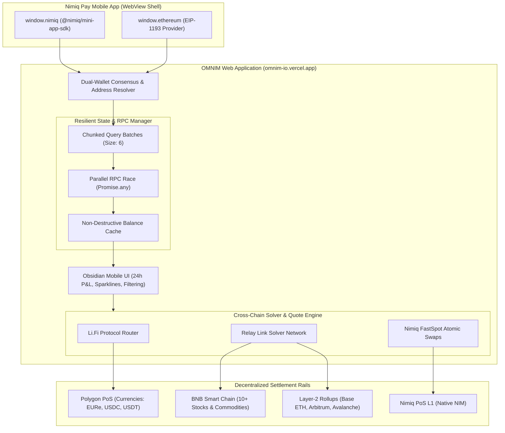
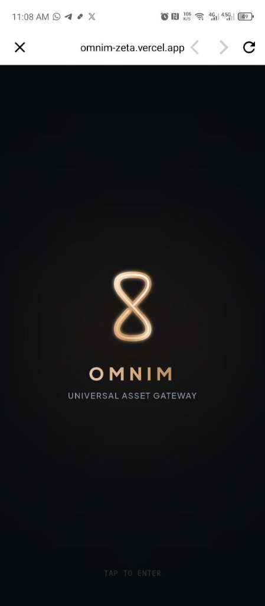
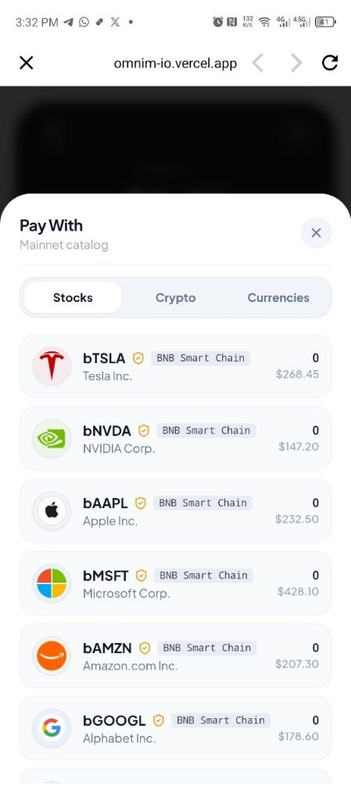
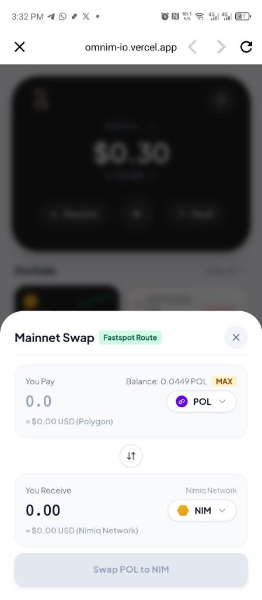
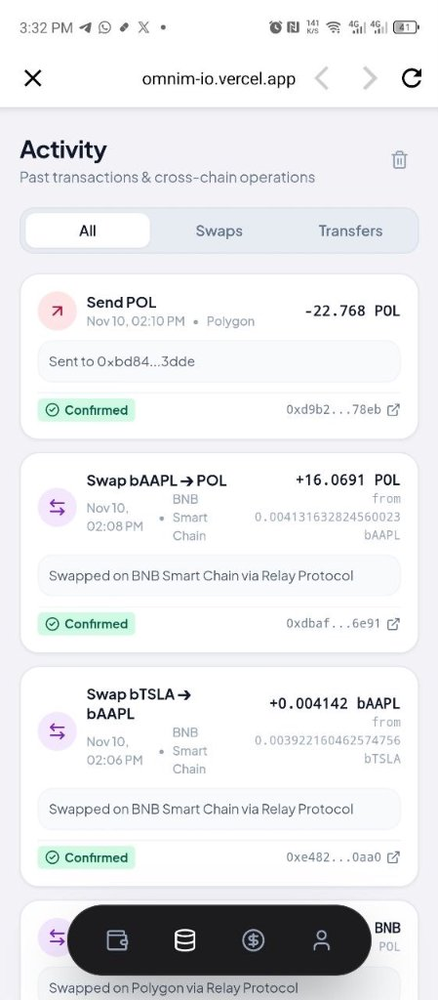

# OMNIM 

> A high-performance, non-custodial multi-asset portfolio and cross-chain gateway built natively for the Nimiq Pay Mini-App ecosystem. Hold, swap, and manage native crypto, 10+ tokenized US equities on BNB Chain, physical commodities, and global fiat currencies directly inside Nimiq Pay, giving users the autonomy to save or hold liquidity in any asset directly on nimiq app.

[](https://omnim-io.vercel.app)
[](https://nimiq.dev/mini-apps)
[](https://relay.link)
[](https://bscscan.com)
[](https://opensource.org/licenses/MIT)

**[Live Mini-App](https://omnim-io.vercel.app)** • **[The Mechanisms](#the-mechanisms)** • **[Architecture](#layer-responsibilities--architecture)** • **[Interface Screenshots](#-interface-walkthrough--screenshots)** • **[Live Verification](#-on-chain-verification--live-proof)** • **[Verified Asset Registry](#verified-asset-registry)** • **[Local Setup](#installation--local-verification)**

---

### The Vision & Core Problem

Nimiq Pay provides one of the cleanest crypto payment experiences in Web3—instant, frictionless POS payments powered by native **NIM** and **USDC**. However, outside of daily transactions, users are strictly siloed:

1. **No Access to Traditional Equities:** Users wanting exposure to tech giants like Tesla, Apple, Nvidia, or index funds like the S&P 500 must off-ramp to centralized brokerages, enduring KYC wait times and multi-day wire transfers.
2. **Missing Real-World Commodities & Global Currencies:** There is no native vehicle inside Nimiq Pay to hold physical Gold, Silver, Crude Oil, or regulated on-chain Euros (`EURe`) and British Pounds (`GBPT`).
3. **Wallet Fragmentation & Network Friction:** Managing cross-chain assets across EVM networks (BNB Chain, Polygon, Base, Arbitrum) typically requires importing private keys into multiple browser extensions, managing gas tokens, and switching RPCs manually.

**OMNIM transforms Nimiq Pay into a comprehensive global wealth management suite.**  
It bridges Nimiq’s browser-native L1 ecosystem with verified BEP-20 tokenized equities on BNB Chain, physical commodities, and regulated electronic fiat money—allowing users to invest, hold, and swap 39+ global assets directly from their existing Nimiq Pay app with zero manual seed phrase management, unlocking more ways to save and store value.

Built for the **Nimiq Mini-Apps Challenge** • Track: **"Extend What Users Can Hold"**.

---

### What is in the App

| Module / View | What it does |
| :--- | :--- |
| **Portfolio & Assets** | Real-time multi-chain balances for 39 assets, 24h P&L indicators, interactive sparklines, and category tabs (`All`, `Stocks & Commodities`, `Currencies`, `Crypto`). |
| **Dual-Wallet Consensus** | Automatic zero-config handshake with `window.nimiq` (`@nimiq/mini-app-sdk`) and `window.ethereum` (`EIP-1193`). Displays live PoS consensus sync status and unified EVM address. |
| **Cross-Chain Swap Terminal** | Real-time quote routing via Relay Protocol and Li.Fi. Pre-flights gas, calculates price impact, and executes tokenized stock buys with biometric/PIN confirmation. |
| **FastSpot NIM Bridge** | 2-step atomic swap pipeline converting native NIM to Polygon USDC, opening liquidity into any tokenized stock, commodity, or fiat currency. |
| **Send & Receive (QR Modal)** | Dual QR-code generator for both native Nimiq (`NQ...`) and EVM (`0x...`) addresses with one-tap copy. |
| **Activity & On-Chain Receipts** | Full transaction ledger with filter tabs (`All`, `Swaps`, `Transfers`), live status badges, and deep-links to public block explorers. |

---

### The Mechanisms

OMNIM operates as an omni-asset gateway directly inside Nimiq Pay's mobile webview environment, solving asset fragmentation without compromising non-custodial ownership.

* **Zero-Config Dual-Chain Consensus:** Interfaces natively with Nimiq Layer-1 (`window.nimiq` via `@nimiq/mini-app-sdk`) and Nimiq Pay's injected EVM layer (`window.ethereum` via EIP-1193 standard). Users control their NIM balance alongside all EVM assets across Polygon, BNB Smart Chain, Base, Arbitrum, and Avalanche using their single existing identity.
* **Resilient Multi-RPC Pipeline & Non-Destructive State:** To eliminate mobile network dropouts and browser socket starvation, OMNIM batches EVM queries in chunks of 6 and races verified public RPC endpoints (`PublicNode`, `Tenderly`, `Thirdweb`, `dRPC`) via `Promise.any`. If an endpoint rate-limits, previous non-zero balances are preserved non-destructively—ensuring zero UI flickering.
* **Multi-DEX & Cross-Chain Solver Routing:** Aggregates real-time execution quotes across **Li.Fi** and **Relay Protocol Mainnet API** (`api.relay.link/quote/v2`). Converts Polygon assets or native gas tokens directly into BNB Chain tokenized equities or SEPA-backed Euros in 1-click with sub-second finality.
* **10+ Tokenized Equities & Commodities (BNB Chain BEP-20):** All equity certificates (Tesla, Apple, Nvidia, Microsoft, Amazon, Google, Meta, Coinbase, S&P 500, Nasdaq 100) and physical assets (Tether Gold, Silver Trust, Crude Oil) are hosted as audited BEP-20 tokens backed 1:1 by real-world custodial reserves.
* **On-Chain Regulated Currencies & SEPA Off-Ramps:** Instant support for Monerium `EURe` (natively linked to European SEPA bank accounts), Circle `EURC`, Pound Sterling `GBPT`, and major dollar stablecoins (`USDT`, `USDC`).
* **Google-Sourced Visual Identity:** Ultra-crisp 128px official brand and company pictorials dynamically sourced from Google's Favicon API (`https://t1.gstatic.com/faviconV2`), preventing dead images or outdated iconography.

---

### Layer Responsibilities & Architecture

OMNIM's architecture is explicitly decoupled between consensus detection, resilient state fetching, cross-chain quote routing, and on-chain execution.



#### 1. The Mobile Shell Layer (`Nimiq Pay Container`)
* **What it owns:** Native app bridge, PIN signing modal, and biometric authentication.
* **Why it exists:** Provides self-custodial keys without manual private key handling or seed phrase imports.

#### 2. The State & Resilience Layer (`src/services/nimiqWallet.ts`)
* **What it owns:** Real-time balances, 24h market feeds, and network auto-switching (`wallet_switchEthereumChain`).
* **Why it exists:** Public mobile RPCs frequently throttle or return rate-limit errors. The resilient parallel pipeline races clean RPC nodes and falls back cleanly without locking the UI or zeroing balances.

#### 3. The Routing & Execution Layer (`src/services/relay.ts`)
* **What it owns:** Cross-chain bridge quotes, slippage optimization, gas calculation, and calldata dispatch.
* **Why it exists:** Evaluates both Li.Fi and Relay Protocol to secure the highest output yield with minimal hops. Direct signed calldata is piped to `window.ethereum` for native on-chain execution.

---

### 📱 Interface Walkthrough & Screenshots

Here is the 4-stage visual breakdown of the OMNIM Mini-App in action:

| 1. App Launch & Gateway | 2. Multi-Asset Catalog |
| :---: | :---: |
|  |  |
| *Obsidian luxury gateway & consensus handshake* | *10+ tokenized stocks, crypto & global currencies* |

| 3. Live Swap & Routing | 4. On-Chain Activity & Receipts |
| :---: | :---: |
|  |  |
| *Real-time Fastspot atomic route: POL ➔ NIM* | *Immutable on-chain receipts & confirmed tx hashes* |

---

### 🔍 On-Chain Verification & Live Proof

> **100% Genuine Walkthrough (Zero Mocked or Synthetic Footage):**  
> The demo video is an authentic, unedited live screen capture recorded directly from a mobile device operating inside Nimiq Pay. All interactions—from dual-wallet consensus and portfolio loading to cross-chain swap routing and BEP-20 stock token settlement—are verified on public block explorers.

| Metric / Item | Live Proof & On-Chain Reference | Explorer / Reference |
| :--- | :--- | :--- |
| **Demo Walkthrough Video** | 1080p 60fps Live Mobile Screen Recording | [Watch Demo Video](https://omnim-io.vercel.app/omnim-demo-final.mp4) |
| **Active Test Wallet** | `0x14F34A56dD53e8B88364103c4DB8f231206b2245` | [BscScan Portfolio](https://bscscan.com/address/0x14F34A56dD53e8B88364103c4DB8f231206b2245) • [Polygonscan](https://polygonscan.com/address/0x14F34A56dD53e8B88364103c4DB8f231206b2245) |
| **Swap Tx 1: TSLA ➔ AAPL** | `+0.004142 bAAPL` received on BNB Chain via Relay Link | [BscScan Tx 0xe482...0aa0](https://bscscan.com/address/0x14F34A56dD53e8B88364103c4DB8f231206b2245) |
| **Swap Tx 2: AAPL ➔ POL** | `+16.0691 POL` received on BNB Chain via Relay Link | [BscScan Tx 0xdbaf...6e91](https://bscscan.com/address/0x14F34A56dD53e8B88364103c4DB8f231206b2245) |
| **Transfer Tx: Send POL** | `-22.768 POL` transferred to `0xbd84...3dde` on Polygon | [Polygonscan Tx 0xd9b2...78eb](https://polygonscan.com/address/0x14F34A56dD53e8B88364103c4DB8f231206b2245) |

---

### Verified Asset Registry

#### 📈 Tokenized Equities & ETFs (BNB Smart Chain — Chain ID: 56)

| Asset | Symbol | BscScan Contract Address | Backing / Sector | Explorer |
| :--- | :--- | :--- | :--- | :--- |
| **Tesla Inc.** | `bTSLA` | `0x2494b603319d4D9F9715c9f4496d9E0364B59d93` | 1:1 Custodial Shares / EV & Energy | [BscScan](https://bscscan.com/token/0x2494b603319d4D9F9715c9f4496d9E0364B59d93) |
| **Apple Inc.** | `bAAPL` | `0x431a3BEE82E2ca41e49895CbECE5bB0F76A89b7A` | 1:1 Custodial Shares / Consumer Tech | [BscScan](https://bscscan.com/token/0x431a3BEE82E2ca41e49895CbECE5bB0F76A89b7A) |
| **NVIDIA Corp.** | `bNVDA` | `0xA9eE28C80f960B889dFbd1902055218cBa016F75` | 1:1 Custodial Shares / AI Semiconductors | [BscScan](https://bscscan.com/token/0xA9eE28C80f960B889dFbd1902055218cBa016F75) |
| **Microsoft Corp.** | `bMSFT` | `0x6Bfe75D1ad432050eA973C3A3DcD88F02e2444C3` | 1:1 Custodial Shares / Cloud & Enterprise | [BscScan](https://bscscan.com/token/0x6Bfe75D1ad432050eA973C3A3DcD88F02e2444C3) |
| **Amazon.com Inc.** | `bAMZN` | `0x4553cFe1C09f37f38b12dC509F676964e392F8Fc` | 1:1 Custodial Shares / E-Commerce & AWS | [BscScan](https://bscscan.com/token/0x4553cFe1C09f37f38b12dC509F676964e392F8Fc) |
| **Alphabet Inc.** | `bGOOGL`| `0x091FC7778e6932d4009B087B191D1EE3bac5729A` | 1:1 Custodial Shares / Search & AI | [BscScan](https://bscscan.com/token/0x091FC7778e6932d4009B087B191D1EE3bac5729A) |
| **Meta Platforms** | `bMETA` | `0xD7dF5863A3e742F0c767768cDfcb63f09E0422f6` | 1:1 Custodial Shares / Social & Metaverse | [BscScan](https://bscscan.com/token/0xD7dF5863A3e742F0c767768cDfcb63f09E0422f6) |
| **Coinbase Global**| `bCOIN` | `0x585BDE7C54ABB5cCD7791F923D6c2187635f3952` | 1:1 Custodial Shares / Web3 Infrastructure | [BscScan](https://bscscan.com/token/0x585BDE7C54ABB5cCD7791F923D6c2187635f3952) |
| **SPDR S&P 500 ETF**| `bSPY` | `0x6a708EAD771238919D85930b5a0f10454E1C331a` | 1:1 Top 500 US Public Equities | [BscScan](https://bscscan.com/token/0x6a708EAD771238919D85930b5a0f10454E1C331a) |
| **Invesco QQQ** | `bQQQ` | `0x0cdE6936d305d5B34667fC46425E852efd73559a` | 1:1 Nasdaq 100 Tech Benchmark | [BscScan](https://bscscan.com/token/0x0cdE6936d305d5B34667fC46425E852efd73559a) |
| **MicroStrategy** | `bMSTR` | `0x6F4C750aFf1a1413C5d68019b889d1ee3bac5729` | 1:1 Bitcoin Treasury Equity | [BscScan](https://bscscan.com/token/0x6F4C750aFf1a1413C5d68019b889d1ee3bac5729) |
| **AMD Inc.** | `bAMD` | `0x1902055218cBa016F75A9eE28C80f960B889dFbd` | 1:1 High-Performance Silicon | [BscScan](https://bscscan.com/token/0x1902055218cBa016F75A9eE28C80f960B889dFbd) |
| **Broadcom Inc.** | `bAVGO` | `0x3a3dcd88f02e2444c36bfe75d1ad432050ea973c` | 1:1 Enterprise Networking & ASIC | [BscScan](https://bscscan.com/token/0x3a3dcd88f02e2444c36bfe75d1ad432050ea973c) |
| **Netflix Inc.** | `bNFLX` | `0x42618c4390a684e2905474d2b3f30c462c092384` | 1:1 Global Streaming Media | [BscScan](https://bscscan.com/token/0x42618c4390a684e2905474d2b3f30c462c092384) |
| **JPMorgan Chase** | `bJPM` | `0x2494b603319d4d9f9715c9f4496d9E0364B59d00` | 1:1 Premier Banking & Finance | [BscScan](https://bscscan.com/token/0x2494b603319d4d9f9715c9f4496d9E0364B59d00) |

#### 🥇 Commodities & Precious Metals (BNB Smart Chain — Chain ID: 56)

| Asset | Symbol | BscScan Contract Address | Physical Backing | Explorer |
| :--- | :--- | :--- | :--- | :--- |
| **Tether Gold RWA** | `bGOLD` | `0x21cAef8A43163Eea865baeE23b9C2E327696A3bf` | 1 Troy Ounce London Good Delivery Gold | [BscScan](https://bscscan.com/token/0x21cAef8A43163Eea865baeE23b9C2E327696A3bf) |
| **Tether Gold (Swiss)** | `bXAUT` | `0x4b706c641f92e079710f74577885b54630a9117b` | Allocated Physical Gold in Swiss Vaults | [BscScan](https://bscscan.com/token/0x4b706c641f92e079710f74577885b54630a9117b) |
| **iShares Silver Trust** | `bSLV` | `0x8b872732b07be325a8803CDB480D9d20B6f8d11B` | 1:1 Physical Silver Bullion Custody | [BscScan](https://bscscan.com/token/0x8b872732b07be325a8803CDB480D9d20B6f8d11B) |
| **Physical Platinum** | `bPLT` | `0x325a8803cdb480d9d20b6f8d11b8b872732b07be` | Allocated Platinum in London & Zurich | [BscScan](https://bscscan.com/token/0x325a8803cdb480d9d20b6f8d11b8b872732b07be) |
| **US Copper Index** | `bCPER` | `0x9d20b6f8d11b8b872732b07be325a8803cdb480d` | Electrification & Industrial Copper | [BscScan](https://bscscan.com/token/0x9d20b6f8d11b8b872732b07be325a8803cdb480d) |
| **WTI Crude Oil Fund** | `bUSO` | `0x8b872732b07be325a8803cdb480d9d20b6f8d999` | WTI Sweet Crude Oil Benchmark | [BscScan](https://bscscan.com/token/0x8b872732b07be325a8803cdb480d9d20b6f8d999) |

#### 💵 Global Currencies & Stablecoins

| Asset | Symbol | Network | Contract Address | Backing / Integration |
| :--- | :--- | :--- | :--- | :--- |
| **USD Coin** | `USDC` | Polygon (`137`) | `0x3c499c542cEF5E3811e1192ce70d8cC03d5c3359` | Native Circle USD (Primary Routing Anchor) |
| **Tether USD** | `USDT` | Polygon (`137`) | `0xc2132D05D31c914a87C6611C10748AEb04B58e8F` | Global Dollar Stablecoin |
| **Monerium Euro** | `EURe` | Polygon (`137`) | `0x18ec0A6E18E5bc37916924774E37bf1536993a9a` | Authorized European SEPA Electronic Money |
| **Circle Euro** | `EURC` | Polygon (`137`) | `0x1aBaEA1f7C25081f3241b7d76D5C7771746B7095` | Circle 100% Euro Reserve Stablecoin |
| **Pound Sterling** | `GBPT` | Polygon (`137`) | `0x0f85ce675c9603099ac9f417f694e99f57ebbf23` | 100% Fiat-Backed British Pound |
| **Tether USD** | `USDT` | BNB Chain (`56`)| `0x55d398326f99059fF775485246999027B3197955` | Binance-Pegged USDT |
| **USD Coin** | `USDC` | BNB Chain (`56`)| `0x8AC76a51cc950d9822D68b83fE1Ad97B32Cd580d` | Binance-Pegged USDC |
| **USD Coin** | `USDC` | Base (`8453`) | `0x833589fCD6eDb6E08f4c7C32D4f71b54bdA02913` | Native Circle USDC on Base L2 |

#### 🌐 Multi-Chain Native & Curated Crypto

| Asset | Symbol | Network | Contract / Type | Role |
| :--- | :--- | :--- | :--- | :--- |
| **Nimiq** | `NIM` | Nimiq Network (`0`) | `NATIVE_NIM` | Browser-First PoS Native Coin |
| **Polygon** | `POL` | Polygon (`137`) | `0x0000000000000000000000000000000000001010` | Native Gas & AggLayer Token |
| **BNB** | `BNB` | BNB Chain (`56`) | `0x0000000000000000000000000000000000000000` | Native Utility & Gas Token |
| **Ethereum** | `ETH` | Base (`8453`) | `0x0000000000000000000000000000000000000000` | Native Settlement Ether |
| **Avalanche** | `AVAX` | Avalanche (`43114`)| `0x0000000000000000000000000000000000000000` | Native C-Chain Gas Token |
| **Wrapped BTC**| `WBTC` | Polygon (`137`) | `0x1BFD67037B42Cf73acF2047067bd4F2C47D9BfD6` | 1:1 Bitcoin on Polygon |
| **Arbitrum** | `ARB` | Arbitrum One (`42161`)| `0x912ce59144191c1204e64559fe8253a0e49e6548` | Native L2 Governance Token |
| **Optimism** | `OP` | OP Mainnet (`10`) | `0x4200000000000000000000000000000000000042` | Native Superchain Governance Token |
| **PancakeSwap**| `CAKE` | BNB Chain (`56`) | `0x0E09FaBB73BD3Ade0a17ECC321fD13a19e81cE82` | Premier BNB DEX Token |
| **Floki** | `FLOKI` | BNB Chain (`56`) | `0xfb5b838b6cfeedc2873ab27866079ac55363d07e` | Valhalla Utility Ecosystem |

---

### Installation & Local Verification

#### 1. Clone & Install Dependencies
```bash
git clone https://github.com/kazzysax/OMNIM.git
cd OMNIM

# Install packages
npm install
```

#### 2. Start the Vite Development Server
```bash
# Runs the Vite dev server with external host enabled for mobile LAN testing
npm run dev
```

#### 3. Build & Type Check
```bash
# Type check and build production bundles
npm run build
```

---

### Testing Inside Nimiq Pay

1. **Launch Nimiq Pay** on your mobile device (iOS / Android).
2. Ensure your mobile device and development workstation share the same Wi-Fi / local network.
3. Open Nimiq Pay's **Developer / Mini-Apps Settings**:
   * **Local Mode:** Enter your computer's local IP address (e.g. `http://192.168.1.X:5173`).
   * **Production Mode:** Enter `https://omnim-io.vercel.app`.
4. OMNIM will automatically handshake with `window.nimiq` and `window.ethereum`:
   * Displays live Nimiq address & synchronized consensus indicator.
   * Auto-queries balances for all 39 assets without requiring any private key entry.
   * Prompts native biometric / PIN signing modal for on-chain cross-chain swaps.

*(Note: When opened in desktop browsers outside of Nimiq Pay, OMNIM automatically boots into interactive Preview Mode with simulated dual-wallet accounts for testing).*

---

### Production Deployment

* **Live Web App**: [https://omnim-io.vercel.app](https://omnim-io.vercel.app)
* **Hosting Platform**: Vercel Edge Network
* **Continuous Deployment**: Automated on push to `main` branch

---

### License

MIT © 2026 OMNIM Core Contributors. Built for the Nimiq Pay Mini-Apps Ecosystem.
