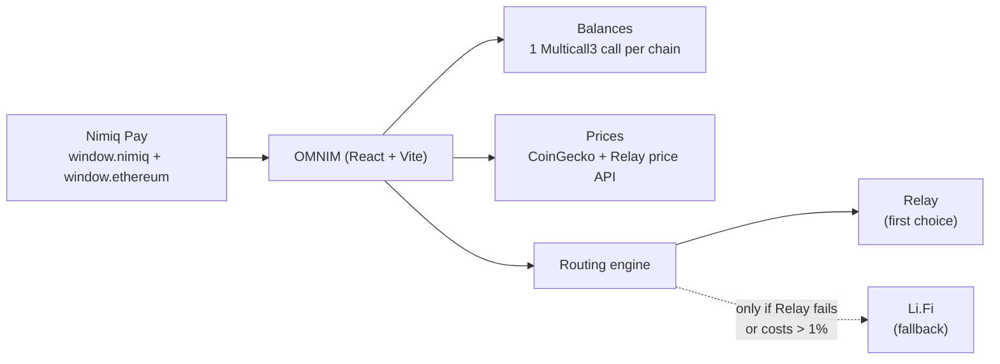

# OMNIM

> A non-custodial multi-asset portfolio and swap app for the **Nimiq Pay** mini-app ecosystem. Hold and swap tokenized stocks, gold, on-chain currencies and crypto across six chains from the wallet you already have in Nimiq Pay.

[](https://omnim-io.vercel.app)
[](https://nimiq.dev/mini-apps)
[](LICENSE)

**[Live app](https://omnim-io.vercel.app)** · **[How it works](#how-it-works)** · **[Assets](#assets)** · **[Verification](#verification)** · **[Setup](#setup)**

Built for the Nimiq Mini-Apps Challenge, track *"Extend What Users Can Hold"*.

---

## What it does

| | |
| :-- | :-- |
| **Portfolio** | Balances for 66 assets across Nimiq, BNB Chain, Polygon, Base, Arbitrum, OP Mainnet and Avalanche, with live USD prices and 24h change. |
| **Swap** | Cross-chain and same-chain swaps routed through Relay and Li.Fi. Shows the real total cost (fees + gas + slippage) before you sign. |
| **Send / Receive** | QR and copy flows for both your Nimiq (`NQ…`) and EVM (`0x…`) addresses. |
| **Activity** | Your own swap and transfer history, stored on your device, with explorer links. |

Keys never leave Nimiq Pay: OMNIM talks to `window.nimiq` (via `@nimiq/mini-app-sdk`) and the injected EIP-1193 `window.ethereum`, and Nimiq Pay shows the PIN or biometric prompt for every transaction. Outside Nimiq Pay (a normal browser) there is no wallet, so balances stay at zero.

## How it works



**Routing** (`src/services/routing.ts`). A quote asks Relay first. If Relay fails or its route costs more than 1%, Li.Fi is asked too and the route that leaves you with more value wins. Cost is measured from the routers' own USD values, and **any route costing more than 5% is blocked**, so a thin-liquidity pool can never be presented as a normal quote. Quotes older than 30 seconds are refreshed before you can sign them. Token approvals are for the exact swap amount, never unlimited.

**Why Relay first?** Li.Fi's free tier allows roughly 75 requests per 2 hours per IP. The app remembers a rate-limit response and skips Li.Fi until it resets. Set `VITE_LIFI_API_KEY` to lift the limit (see [Setup](#setup)).

**Prices** (`src/services/prices.ts`). Majors (NIM, BNB, ETH, POL, AVAX, ARB, OP, BTC) come from CoinGecko with its 24h change. Everything else is priced by Relay's token price API, the same source Relay uses to value quotes. Relay provides no 24h change, so it is computed from price samples saved on your device and shows `0.00%` until a day of history exists. A price that jumps more than 35% between refreshes is ignored as a glitch.

**Balances** (`src/services/balances.ts`). One batched Multicall3 `eth_call` per chain, raced across public RPC endpoints. If a chain's RPC fails, the previous balance is kept instead of dropping to zero.

## Assets

Every asset below passes `npm run verify:assets`: the contract exists on-chain with matching decimals, and Relay and/or Li.Fi return a real quote at a low cost (see [Verification](#verification)). Tokens that did not route cheaply are **not** listed.

### Tokenized stocks and ETFs (BNB Chain)

Issued by [Ondo Global Markets](https://ondo.finance/global-markets) (`…on` symbols) plus Apple (`AAPLB`). Ondo tokens are not available to US persons. Check the issuer's terms before trading.

| Symbol | Name | Chain | Contract |
| :-- | :-- | :-- | :-- |
| `AAPLB` | Apple | BNB Chain | [`0x431a…9b7A`](https://bscscan.com/token/0x431a3BEE82E2ca41e49895CbECE5bB0F76A89b7A) |
| `AMZNon` † | Amazon.com, Inc. | BNB Chain | [`0x4553…F8Fc`](https://bscscan.com/token/0x4553cFe1C09f37f38b12dC509F676964e392F8Fc) |
| `ARMon` | Arm Holdings plc | BNB Chain | [`0x527C…1dD6`](https://bscscan.com/token/0x527C6436E1eAa4f2065CDE4090F798Cb5D031dD6) |
| `DISon` | Disney | BNB Chain | [`0xeEe9…ACFa`](https://bscscan.com/token/0xeEe9eeE593cB8f7946260B4066CBa7907f40ACFa) |
| `DRAMon` | Roundhill Memory ETF | BNB Chain | [`0x087b…1564`](https://bscscan.com/token/0x087b5761b161429013d41eA54cd2fb6022A21564) |
| `FXIon` | iShares China Large-Cap ETF | BNB Chain | [`0x9b8E…EEA1`](https://bscscan.com/token/0x9b8E987e6fEc8Cf1380C4dcA7071e2C7853AEEA1) |
| `GOOGLon` | Alphabet Inc. | BNB Chain | [`0x091F…729A`](https://bscscan.com/token/0x091FC7778e6932d4009B087B191D1EE3bac5729A) |
| `IBITon` | iShares Bitcoin Trust | BNB Chain | [`0x68B0…9Ec7`](https://bscscan.com/token/0x68B07cEf227Cea1b2b6683921C8c825cd5C69Ec7) |
| `METAon` † | Meta Platforms, Inc. | BNB Chain | [`0xD7dF…22f6`](https://bscscan.com/token/0xD7dF5863A3e742F0c767768cDfcb63f09E0422f6) |
| `MSFTon` † | Microsoft Corporation | BNB Chain | [`0x6Bfe…44C3`](https://bscscan.com/token/0x6Bfe75D1ad432050eA973C3A3DcD88F02e2444C3) |
| `MSTRon` † | MicroStrategy | BNB Chain | [`0x7313…8992`](https://bscscan.com/token/0x7313EA16493b2f55054Df0131A3A14B043ec8992) |
| `NVDAon` | Nvdia Corporation | BNB Chain | [`0xA9eE…6F75`](https://bscscan.com/token/0xA9eE28C80f960B889dFbd1902055218cBa016F75) |
| `QQQon` † | Invesco QQQ | BNB Chain | [`0x0cdE…559a`](https://bscscan.com/token/0x0cdE6936d305d5B34667fC46425E852efd73559a) |
| `SKHYon` | SK Hynix | BNB Chain | [`0x4268…299F`](https://bscscan.com/token/0x4268F2Bfb23A7496504AA5eD1Ee325248586299F) |
| `SLVon` | iShares Silver Trust | BNB Chain | [`0x8b87…d11B`](https://bscscan.com/token/0x8b872732b07be325a8803CDB480D9d20B6f8d11B) |
| `SNDKon` | SanDisk | BNB Chain | [`0x4Fd6…a2A4`](https://bscscan.com/token/0x4Fd67CB8CFEdc718BAc984b5936abE3330d0a2A4) |
| `SPCXon` | SpaceX | BNB Chain | [`0xd0a5…A928`](https://bscscan.com/token/0xd0a58BC9D88D3FF48C0294Cb7e45937d0E41A928) |
| `SPYon` | SPDR S&P 500 ETF | BNB Chain | [`0x6a70…331a`](https://bscscan.com/token/0x6a708EAD771238919D85930b5a0f10454E1C331a) |
| `STRCon` | Strategy Stretch Preferred | BNB Chain | [`0x71E9…0c89`](https://bscscan.com/token/0x71E9dc9DEbc18650BD2342B93623B88C2aD00c89) |
| `TSLAon` † | Tesla Inc. | BNB Chain | [`0x2494…9d93`](https://bscscan.com/token/0x2494b603319d4D9F9715c9f4496d9E0364B59d93) |

### Gold

| Symbol | Name | Chain | Contract |
| :-- | :-- | :-- | :-- |
| `XAUt` | Tether Gold | BNB Chain | [`0x21cA…A3bf`](https://bscscan.com/token/0x21cAef8A43163Eea865baeE23b9C2E327696A3bf) |
| `PAXG` | Paxos Gold | Arbitrum | [`0xfEb4…8429`](https://arbiscan.io/token/0xfEb4DfC8C4Cf7Ed305bb08065D08eC6ee6728429) |

### Currencies

| Symbol | Name | Chain | Contract |
| :-- | :-- | :-- | :-- |
| `tGBP` | tGBP | BNB Chain | [`0x27f6…5287`](https://bscscan.com/token/0x27f6c8289550fCE67f6B50BeD1F519966aFE5287) |
| `AUDF` | Forte AUD | Polygon | [`0xd2a5…456b`](https://polygonscan.com/token/0xd2a530170D71a9Cfe1651Fb468E2B98F7Ed7456b) |
| `BRZ` | Brazilian Digital | Polygon | [`0x4eD1…75Dc`](https://polygonscan.com/token/0x4eD141110F6EeeAbA9A1df36d8c26f684d2475Dc) |
| `EURC` | EURC | Base | [`0x60a3…db42`](https://basescan.org/token/0x60a3E35Cc302bFA44Cb288Bc5a4F316Fdb1adb42) |
| `EURS` | STASIS EURS Token (PoS) | Polygon | [`0xE111…Ae99`](https://polygonscan.com/token/0xE111178A87A3BFf0c8d18DECBa5798827539Ae99) |
| `EURe` | Monerium EURe | Polygon | [`0xE0aE…Ea8d`](https://polygonscan.com/token/0xE0aEa583266584DafBB3f9C3211d5588c73fEa8d) |
| `JPYC` | JPY Coin | Polygon | [`0xE7C3…3c29`](https://polygonscan.com/token/0xE7C3D8C9a439feDe00D2600032D5dB0Be71C3c29) |
| `MXNB` | MXNB | Base | [`0xF197…80aA`](https://basescan.org/token/0xF197FFC28c23E0309B5559e7a166f2c6164C80aA) |
| `XSGD` | XSGD | Polygon | [`0xDC33…1995`](https://polygonscan.com/token/0xDC3326e71D45186F113a2F448984CA0e8D201995) |
| `XZAR` | South African Tether (PoS) | Polygon | [`0x30DE…33cB`](https://polygonscan.com/token/0x30DE46509Dbc3a491128F97be0aAf70dc7Ff33cB) |
| `tGBP` | tGBP | Polygon | [`0x27f6…5287`](https://polygonscan.com/token/0x27f6c8289550fCE67f6B50BeD1F519966aFE5287) |

### Stablecoins

| Symbol | Name | Chain | Contract |
| :-- | :-- | :-- | :-- |
| `FDUSD` | First Digital USD | BNB Chain | [`0xc5f0…6409`](https://bscscan.com/token/0xc5f0f7b66764F6ec8C8Dff7BA683102295E16409) |
| `USDC` | USD Coin (BNB Chain) | BNB Chain | [`0x8AC7…580d`](https://bscscan.com/token/0x8AC76a51cc950d9822D68b83fE1Ad97B32Cd580d) |
| `USDT` | Tether USD (BNB Chain) | BNB Chain | [`0x55d3…7955`](https://bscscan.com/token/0x55d398326f99059fF775485246999027B3197955) |
| `DAI` | Dai | Polygon | [`0x8f3C…A063`](https://polygonscan.com/token/0x8f3Cf7ad23Cd3CaDbD9735AFf958023239c6A063) |
| `USDC` | USD Coin | Polygon | [`0x3c49…3359`](https://polygonscan.com/token/0x3c499c542cEF5E3811e1192ce70d8cC03d5c3359) |
| `USDC` | USD Coin (Base) | Base | [`0x8335…2913`](https://basescan.org/token/0x833589fCD6eDb6E08f4c7C32D4f71b54bdA02913) |
| `USDT` | Tether USD | Polygon | [`0xc213…8e8F`](https://polygonscan.com/token/0xc2132D05D31c914a87C6611C10748AEb04B58e8F) |

### Crypto

| Symbol | Name | Chain | Contract |
| :-- | :-- | :-- | :-- |
| `BNB` | BNB | BNB Chain | native gas token |
| `AVAX` | Avalanche | Avalanche | native gas token |
| `ETH` ‡ | Ethereum | Base | native gas token |
| `POL` | Polygon | Polygon | native gas token |
| `AAVE` | Aave (BNB Chain) | BNB Chain | [`0xfb61…f802`](https://bscscan.com/token/0xfb6115445Bff7b52FeB98650C87f44907E58f802) |
| `BTCB` | Bitcoin (BTCB) | BNB Chain | [`0x7130…ad9c`](https://bscscan.com/token/0x7130d2A12B9BCbFAe4f2634d864A1Ee1Ce3Ead9c) |
| `CAKE` | PancakeSwap | BNB Chain | [`0x0E09…cE82`](https://bscscan.com/token/0x0E09FaBB73BD3Ade0a17ECC321fD13a19e81cE82) |
| `DOGE` | Dogecoin (BNB Chain) | BNB Chain | [`0xbA2a…4C43`](https://bscscan.com/token/0xbA2aE424d960c26247Dd6c32edC70B295c744C43) |
| `DOT` | Polkadot (BNB Chain) | BNB Chain | [`0x7083…3402`](https://bscscan.com/token/0x7083609fCE4d1d8Dc0C979AAb8c869Ea2C873402) |
| `LINK` | Chainlink (BNB Chain) | BNB Chain | [`0xF8A0…51bD`](https://bscscan.com/token/0xF8A0BF9cF54Bb92F17374d9e9A321E6a111a51bD) |
| `LTC` | Litecoin (BNB Chain) | BNB Chain | [`0x4338…DB94`](https://bscscan.com/token/0x4338665CBB7B2485A8855A139b75D5e34AB0DB94) |
| `SOL` | Solana (BNB Chain) | BNB Chain | [`0x570A…43dF`](https://bscscan.com/token/0x570A5D26f7765Ecb712C0924E4De545B89fD43dF) |
| `TRX` | TRON (BNB Chain) | BNB Chain | [`0xCE7d…12e3`](https://bscscan.com/token/0xCE7de646e7208a4Ef112cb6ed5038FA6cC6b12e3) |
| `TWT` | Trust Wallet Token | BNB Chain | [`0x4B0F…8003`](https://bscscan.com/token/0x4B0F1812e5Df2A09796481Ff14017e6005508003) |
| `UNI` | Uniswap (BNB Chain) | BNB Chain | [`0xBf51…e9B1`](https://bscscan.com/token/0xBf5140A22578168FD562DCcF235E5D43A02ce9B1) |
| `XRP` | XRP (BNB Chain) | BNB Chain | [`0x1D2F…0dBE`](https://bscscan.com/token/0x1D2F0da169ceB9fC7B3144628dB156f3F6c60dBE) |
| `AERO` | Aerodrome | Base | [`0x9401…8631`](https://basescan.org/token/0x940181a94A35A4569E4529A3CDfB74e38FD98631) |
| `ARB` | Arbitrum | Arbitrum | [`0x912C…6548`](https://arbiscan.io/token/0x912CE59144191C1204E64559FE8253a0e49E6548) |
| `GMX` | GMX | Arbitrum | [`0xfc5A…ad0a`](https://arbiscan.io/token/0xfc5A1A6EB076a2C7aD06eD22C90d7E710E35ad0a) |
| `OP` | Optimism | OP Mainnet | [`0x4200…0042`](https://optimistic.etherscan.io/token/0x4200000000000000000000000000000000000042) |
| `PENDLE` | Pendle | Arbitrum | [`0x0c88…c9e8`](https://arbiscan.io/token/0x0c880f6761F1af8d9Aa9C466984b80DAb9a8c9e8) |
| `VIRTUAL` | Virtuals Protocol | Base | [`0x0b3e…7E1b`](https://basescan.org/token/0x0b3e328455c4059EEb9e3f84b5543F74E24e7E1b) |
| `WBTC` | Wrapped Bitcoin | Polygon | [`0x1BFD…BfD6`](https://polygonscan.com/token/0x1BFD67037B42Cf73acF2047067bd4F2C47D9BfD6) |
| `WETH` | Wrapped Ether (Polygon) | Polygon | [`0x7ceB…f619`](https://polygonscan.com/token/0x7ceB23fD6bC0adD59E62ac25578270cFf1b9f619) |
| `cbBTC` | Coinbase Wrapped BTC | Base | [`0xcbB7…33Bf`](https://basescan.org/token/0xcbB7C0000aB88B473b1f5aFd9ef808440eed33Bf) |

NIM (native Nimiq) is shown with balance and price. **Swaps to and from NIM are paused** while the Fastspot atomic-swap relayer is unavailable.

† Verified buying at $20 through Li.Fi, but the Li.Fi rate limit prevented a full re-check of selling and $200 depth on the day of listing. Run `npm run verify:assets` with a Li.Fi key to complete it.
‡ Can be sold but not bought: Relay cannot route stablecoin → native ETH on this chain.

Other xStocks and Backed bTokens exist on-chain, but at the time of verification no Relay or Li.Fi route could trade them at a sane price (quotes returned losses of 30–99%), so they are intentionally excluded.

## Verification

```bash
npm run verify:assets            # on-chain + routing checks for every listed asset
npm run verify:assets:onchain    # on-chain checks only (no router quota used)
node scripts/verify-assets.mjs candidates.json --write verified.json   # vet new tokens
```

For each asset the script checks the contract and `decimals()` on-chain, then requires a **$20 buy, a $200 buy and a $20 sell** to cost under 2.5% / 3.5% / 3.5% according to the routers' own USD values. It queries Relay first and falls back to Li.Fi like the app does, and exits non-zero on any failure. Add a token by putting it in a candidates file, verifying, and merging the result into `src/config/assets.registry.json`.

## Setup

```bash
git clone https://github.com/kazzysax/OMNIM.git && cd OMNIM
npm install
npm run dev        # Vite dev server, reachable on your LAN for phone testing
npm run build      # type-check + production build
```

Optional environment variable:

| Variable | Purpose |
| :-- | :-- |
| `VITE_LIFI_API_KEY` | Li.Fi API key. Without it the free tier (~75 requests / 2h per IP) applies and the app falls back to Relay-only when it is exhausted. |

**Testing inside Nimiq Pay:** open Nimiq Pay's Mini-Apps developer settings and enter your machine's LAN address (e.g. `http://192.168.1.X:5173`) or `https://omnim-io.vercel.app`.

## Project layout

```
src/
  config/assets.registry.json   verified token list (data)
  config/assets.ts              builds typed assets from the registry
  services/routing.ts           Relay + Li.Fi quote engine and cost guard
  services/prices.ts            live prices and local 24h history
  services/balances.ts          Multicall3 batched balances
  services/nimiqWallet.ts       Nimiq Pay + EIP-1193 wallet bridge
scripts/verify-assets.mjs       on-chain and routing verifier
```

## Deployment

Hosted on Vercel; pushes to `main` deploy automatically.

## License

MIT © 2026 OMNIM Core Contributors.
